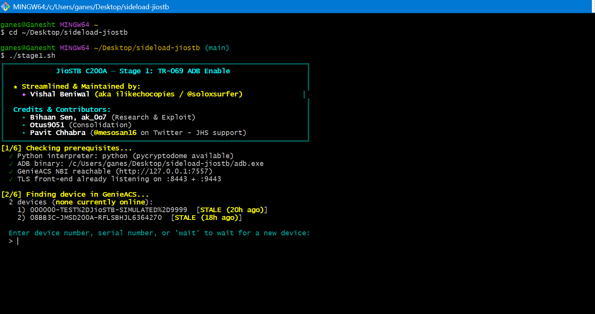

# Jio AirFiber STB — Full Modification Guide

Complete guide to unlock, debloat, and extend the Jio AirFiber Set-Top Box (Android TV).

This is a **two-phase process**:
1. **Enable ADB** on the STB (requires Docker, DNS exploit via TR-069)
2. **Post-ADB setup** — install custom launcher, upgrade JioTV+, install apps

---

## Phase 1 — Enable ADB on the STB

> ⚠️ Jio locks down the STB. Developer Options cannot be enabled the standard Android way (tapping Build Number). ADB must be unlocked via a TR-069/CWMP exploit using a custom DNS server and Docker.

### PC Requirements for Phase 1

| Tool | Purpose | Download |
|------|---------|----------|
| **Docker Desktop** | Hosts local GenieACS/TLS backend | [docs.docker.com](https://docs.docker.com/desktop/setup/install/windows-install/) |
| **Python 3** | Runs proxy and diagnostic scripts (add to PATH) | [python.org](https://www.python.org/downloads/) |
| **Technitium DNS** | Overrides local DNS to intercept STB traffic | [technitium.com](https://technitium.com/dns/) |
| **Git for Windows** | Bash terminal to run `.sh` scripts | [gitforwindows.org](https://gitforwindows.org/) |
| **USB pendrive** | Needed for the USB bug to access hidden STB settings |  |

### Real Experience — What to Expect

> This process took **~6 hours** on first attempt. Do not start unless you have enough time and patience.
> Once ADB is connected, everything in Phase 2 (debloat, JioTV+, Kodi) is straightforward.

Key things that are not obvious:
- **Git Bash is required.** The `.sh` scripts will not run in Command Prompt or PowerShell. Open Git Bash inside the `sideload-jiostb` folder.
- **The ADB prompt does not appear immediately.** It only appears on the STB screen **after** `stage1.sh` completes AND the STB does a cold reboot (unplug from wall, not standby).
- **Windows Firewall must be turned off** during the process. The STB needs to reach your PC on ports 53 (DNS), 8443 and 9443 (TLS proxy).
- **The STB only contacts the ACS on boot.** If nothing happens after `stage1.sh`, cold power cycle the STB (unplug from wall, wait 5 seconds, plug back in).
- Once the ADB prompt appears on TV — check **"Always allow from this computer"** → OK → then run `adb connect` again.

### Git Bash Commands

Open Git Bash inside the `sideload-jiostb` folder and run:

```bash
cd ~/Desktop/sideload-jiostb
./stage1.sh
```

The script checks all prerequisites automatically:



What you see when it's working:
- `[1/6] Checking prerequisites...` — Python, ADB binary, GenieACS NBI, TLS ports all show ✓
- `[2/6] Finding device in GenieACS...` — your STB serial number appears (e.g. `JMSD200A-...`)
- Enter your device number when prompted, then cold power cycle the STB

### Follow the sideload-jiostb guide

The full step-by-step is documented in the **sideload-jiostb** toolkit by u/ilikechocopies:  
👉 **https://github.com/ilikechocopies/sideload-jiostb**

That toolkit handles:
- Intercepting the STB's TR-069 CWMP check-in via Docker + Technitium DNS
- Running `stage1.sh` to enable network ADB (expires 2037)
- Installing Monet Launcher and Shevery
- Disabling startup ads and OTA auto-updates

**Supported hardware:** JMSC200Av2, JMSB200A, JHSC200 (JioOS 2.0)

Once stage1.sh succeeds and the STB reboots, ADB is active at `<STB_IP>:5555`. Proceed to Phase 2.

---

## Phase 2 — Post-ADB Setup

After ADB is enabled, run the scripts in this repo to finish the setup.

### PC Requirements for Phase 2

| Requirement | Notes |
|-------------|-------|
| ADB (bundled in sideload-jiostb) | Already included as `adb.exe` in the toolkit folder |
| curl | Built into Windows 10/11 — no install needed |
| STB and PC on the same network | ADB over WiFi — STB connects to your router or PC hotspot |

### Edit config.bat

Before running any script, open `config.bat` and fill in your values:

```batch
set ADB=C:\path\to\sideload-jiostb\adb.exe    :: path to adb.exe
set STB=192.168.x.x:5555                        :: your STB IP address
set APKDIR=C:\path\to\jiotvplus_6010            :: only for install-jiotvplus.bat
```

---

## Step 1 — Connect ADB

```
connect.bat
```

STB and PC must be on the same network (same WiFi router, or STB connected to PC hotspot).

If it fails: check STB IP, make sure ADB over Network is enabled on the STB (it stays on after stage1.sh).

---

## Step 2 — Apply STB Modifications (run once)

```
setup.bat
```

| Step | Action | Package / Command |
|------|--------|---------|
| 1 | Enable Jio SSO STB (login for JioTV+ v2.x) | `com.media.jio.sso.stb` |
| 2 | Set Monet as default home launcher | `com.klevico.monet` |
| 3 | Disable JioStore (stops auto app downloads/updates permanently) | `com.jio.store` |
| 4 | Disable Jio background data collector | `com.jio.adc.embedded` |
| 5 | Disable Jio Patchwall launcher | `com.jio.android.jiolauncher` |
| 6 | Enable dark mode permanently (Jio firmware updates keep removing it) | `cmd uimode night yes` |

> Note: `com.jio.httpupdate`, `com.jio.usbupdate`, and `com.jio.stb.rcuupdate` are already disabled by `stage1.sh`.

Reboot STB after for changes to take effect.

---

## Step 3 — Upgrade JioTV+ to v6 (optional)

The STB ships with JioTV+ v2.6.7. The Android TV / Play Store build (v6.0.10) has a better UI. Jio stopped publishing v6 updates to the STB via JioStore, so this is a manual install.

### Get the APK splits

1. Go to **APKMirror**, search for **JioTV+ 6.0.10**
2. Download the **APKS** bundle (not the APK)
3. Rename `.apkm` → `.zip` and extract it
4. Set `APKDIR` in `config.bat` to that extracted folder

Required files (STB is 32-bit ARM / `armeabi-v7a`):
- `base.apk`
- `split_config.armeabi_v7a.apk`
- `split_config.xhdpi.apk`
- `split_config.en.apk`

```
install-jiotvplus.bat
```

---

## Step 4 — Install Aurora Store (optional)

Aurora Store is a Google Play Store client — it has access to all Play Store apps. Install it once via ADB:

```batch
adb -s <STB_IP>:5555 install "C:\path\to\sideload-jiostb\AuroraStore-4.8.4.apk"
```

After install, open it on the STB and:
1. Choose **Anonymous** (no Google account needed)
2. Go to **Settings → Interface → Enable TV Mode** for a remote-friendly layout

> Aurora Store is already bundled inside the `sideload-jiostb` folder as `AuroraStore-4.8.4.apk`.

---

## Step 5 — Fix Kodi EPG (when needed)

If Kodi's EPG/guide stops loading:

```
fix-kodi.bat
```

Checks Kodi JSONRPC on port 8080. If not responding, clears app data and restarts.

---

## ADB Quick Reference

```batch
set ADB=C:\path\to\adb.exe
set STB=192.168.x.x:5555

:: Connect
%ADB% connect %STB%

:: Launch JioTV+ v6
%ADB% -s %STB% shell am start -n "com.jio.media.jiotvplus/com.jio.jioplay.jiotvplustwo.MainActivity"

:: Check JioTV+ version
%ADB% -s %STB% shell dumpsys package com.jio.media.jiotvplus | findstr versionName

:: Enable or disable any package
%ADB% -s %STB% shell pm enable <package.name>
%ADB% -s %STB% shell pm disable-user --user 0 <package.name>

:: Install any APK
%ADB% -s %STB% install "C:\path\to\app.apk"

:: List all packages
%ADB% -s %STB% shell pm list packages

:: Reboot STB
%ADB% -s %STB% reboot

:: Screenshot (black = DRM/live TV playing — normal)
%ADB% -s %STB% shell screencap -p /sdcard/screen.png
%ADB% -s %STB% pull /sdcard/screen.png .\screen.png

:: Live log
%ADB% -s %STB% logcat
```

---

## Notes

| Topic | Detail |
|-------|--------|
| Developer Options | NOT accessible via standard Android method on Jio STB — use stage1.sh |
| Patchwall | Jio STB home screen — aggregates from JioTV+ and OTTs, does not own content |
| JioStore | Handles app updates on STB (not OTA). Jio stopped publishing JioTV+ v6 via JioStore |
| v6 vs v2 | Same package name. v6 = Android TV / Play Store build. v2.6.7 = factory STB build |
| Black screencap | Expected during live TV — HDCP/DRM secure surface |
| SSO STB app | `com.media.jio.sso.stb` needed for v2.x login only. v6 handles auth internally |
| Package installer | Jio disabled the stock APK installer UI — always install via ADB |
